<div align="center">


<br>

[](https://github.com/madrays/trackferry/releases)
[](https://github.com/madrays/trackferry/stargazers)
[](https://hub.docker.com/r/madrays/trackferry)
[](LICENSE)


<br><br>

<a href="#快速开始"></a>
<a href="#功能"></a>
<a href="#界面"></a>
<a href="#文档"></a>
<a href="https://github.com/madrays/trackferry"></a>

</div>

<br>

<p align="center">家里会出声的东西，从今天起听同一个人的。</p>

<br>

TrackFerry 住在你的 NAS 里。小爱音箱、电视、DLNA 功放、Chromecast，还有你手里这台手机，只要能出声，它就能让那里响起你想听的那首歌。

歌先从自己的地盘找：飞牛音乐，或者一个普通的音乐文件夹。找不到，再去酷我、酷狗、咪咕、网易云要免费完整版。都没有，才把话筒还给小爱。

歌还会跟着你走。厨房音箱上放到一半，坐到沙发上在“切换到”里点一下电视，它就从刚才那一秒接着唱；出门前再接回手机，后面排着的歌一首不丢。一首歌，在家里每一只喇叭之间接力。

你只管开口，或者点一下。

## 全能力拓扑


三端各司其职：

- **服务端**：NAS 上一个 Docker 容器，是大脑。听小爱的对话、找歌、推流、记账，网页关了它照样干活。
- **网页**：手机、平板、电脑打开就能用，装到主屏就是一个应用。遥控所有喇叭，也能自己出声。
- **电视端**：Android TV 应用。大屏点歌、看歌词，自己就是一只喇叭，也能被手机遥控、和手机互相接力。

## 一句话，三秒钟

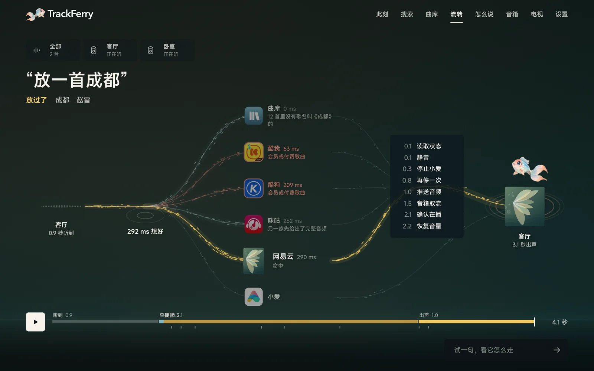

对客厅的小爱说“放一首成都”。

曲库里没有。四家在线源同时问，网易云先给出完整版。TrackFerry 先让小爱安静，再把歌推给音箱，等音箱真的取了流、报了在播，最后把音量还回去。从听到这句话到第一声出来，3.1 秒。

这一路经过了谁、为什么选这首、每一步花了多久，都画在“流转”页上，事后还能回放。小爱嘴快想抢在前奏前面说“好的”？有三种压法，按音箱选。

## 功能


<table>
<tr>
<td width="33%" valign="top"><h3>🗣️ 开口点歌</h3>歌名、歌手、专辑、歌单、收藏都能点。“换成林屿的版本”“换个版本”“收藏这首”也接得住，听错一个字会按曲库纠正。</td>
<td width="33%" valign="top"><h3>🎵 自己的曲库</h3>飞牛音乐的歌、封面、歌词、收藏、歌单全同步，收藏和加歌单写回飞牛。没装飞牛，挂一个音乐文件夹也是完整曲库。</td>
<td width="33%" valign="top"><h3>🌊 在线补歌</h3>曲库没有的，从酷我、酷狗、咪咕、网易云找免费完整版；登录自己的网易云，会员能听的也能放。每个来源单独开关。</td>
</tr>
<tr>
<td valign="top"><h3>📡 投放</h3>DLNA 和 Chromecast 设备直接出现在“切换到”里，由服务器驱动。设备掉线自动重连，被别的应用占着不硬抢。</td>
<td valign="top"><h3>📺 电视端</h3>同一局域网里自动找到 NAS，输入配对码就连上。曲库、搜索、歌词都在大屏上，声音从电视出。</td>
<td valign="top"><h3>🔀 接力</h3>正在放的歌，从音箱推到电视，从电视接回手机，接着刚才的位置放，后面排着的歌一首不丢。</td>
</tr>
<tr>
<td valign="top"><h3>🎚️ 真实音质</h3>“此刻”页标的是实际取到的格式和码率，不是猜的。点一下看同一首歌的其他版本，从当前进度换过去。</td>
<td valign="top"><h3>🔁 连续播放</h3>专辑、歌手、收藏、歌单整张放；点一首就从曲库随机接下去，音箱、网页、电视同一套规则。随机、顺序、单曲循环任选，还能设最长时间。</td>
<td valign="top"><h3>⏭️ 下一首放</h3>想听的排到后面，不打断正在放的。说“下一首”“上一首”也行。</td>
</tr>
<tr>
<td valign="top"><h3>⏯️ 断点续播</h3>听歌时和小爱聊两句，聊完从刚才的位置接着放。说了暂停，就真的停。</td>
<td valign="top"><h3>🤫 压住小爱</h3>普通、加强、等她说完，三种方式按音箱选。小爱负责听，TrackFerry 负责放。</td>
<td valign="top"><h3>🔊 多台音箱</h3>每台各放各的，分别设为不接入、观察或接管。观察只记录会放什么，不出声，适合先试再交权。</td>
</tr>
<tr>
<td valign="top"><h3>📝 缺歌清单</h3>线上放过、曲库还没有的歌自动记下，带点播次数，可导出。补进曲库后自己消失。</td>
<td valign="top"><h3>🏠 Home Assistant</h3>每只音箱都是一个媒体播放器，状态实时推送，歌词、队列和控制都能接进自动化。</td>
<td valign="top"><h3>⬆️ 一键更新</h3>设置页点一下就升级。更新包验签，新版本起不来自动退回旧版本。</td>
</tr>
</table>

## 界面

### 📱 手机：口袋里的总控台

<p align="center">
  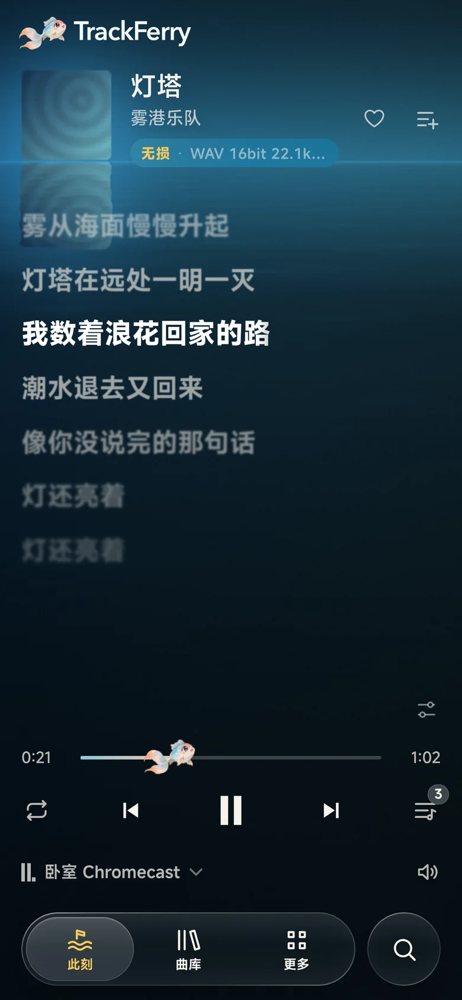
  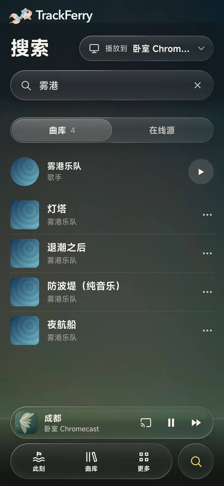
  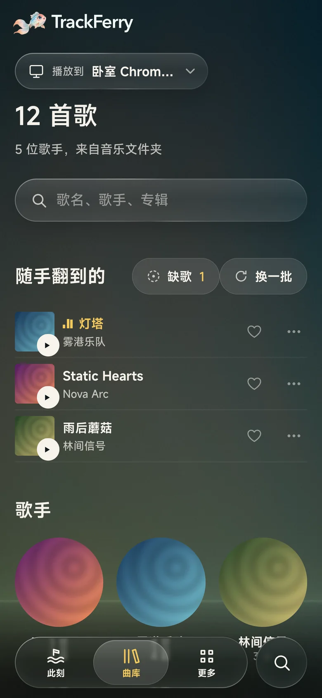
  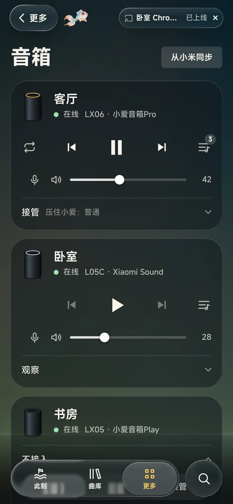
</p>

<p align="center">
  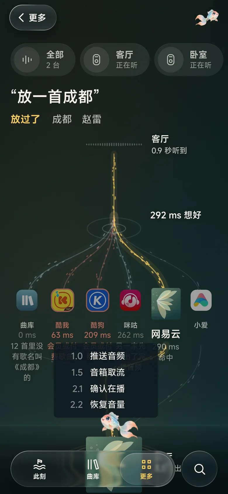
  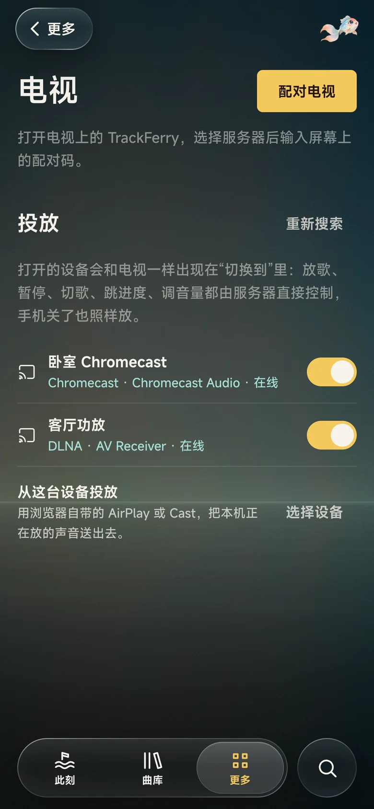
  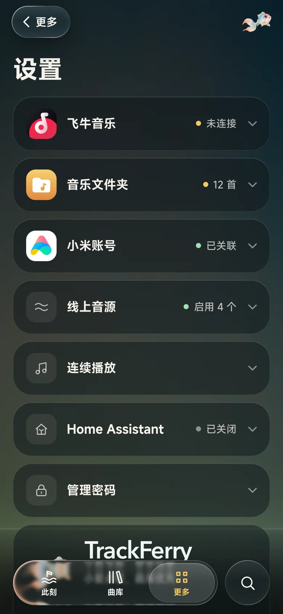
  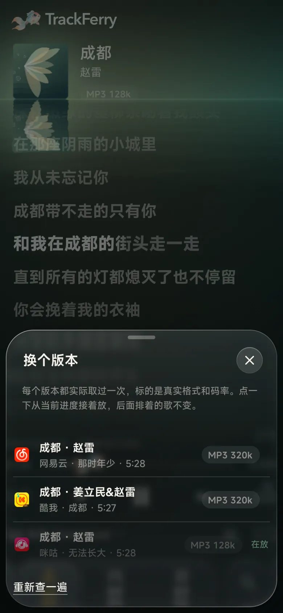
</p>

- **此刻**：歌词跟着唱，切歌、拖进度、调音量、换播放方式、收藏、加歌单、换一只喇叭，都在一屏里
- **搜索**：曲库和在线源一起搜，点一下就放，也能排到下一首
- **曲库**：收藏、歌单、歌手、随手翻到的，每一处都能整张、整单连播
- **音箱**：每台的模式、音量、队列和压住小爱的方式，一眼看完
- **电视和投放**：配对电视，开关 DLNA 和 Chromecast；也能用浏览器自带的 AirPlay 或 Cast 把这台手机的声音送出去
- **整页跟着封面变色**，底栏是会折射的液态玻璃。好看不算功能，但确实好看

### 🖥️ 电脑：同一套，更宽

| 此刻 | 曲库 |
| :---: | :---: |
| 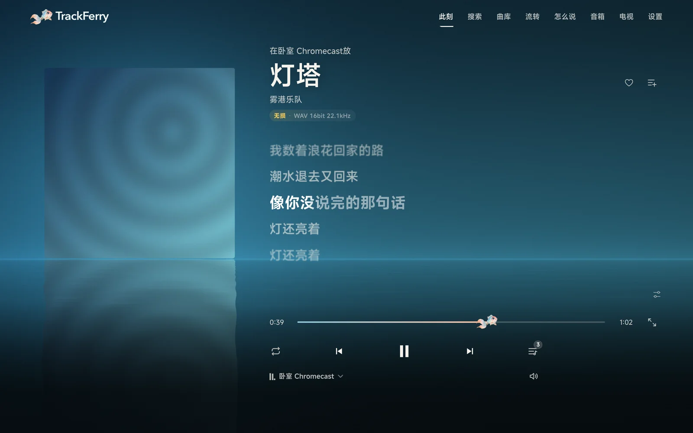 | 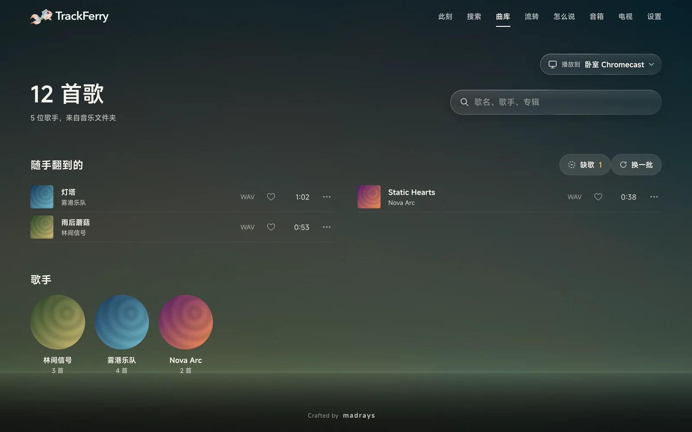 |

### 📺 电视：大屏也归它管

| 首页 | 正在播放 |
| :---: | :---: |
| 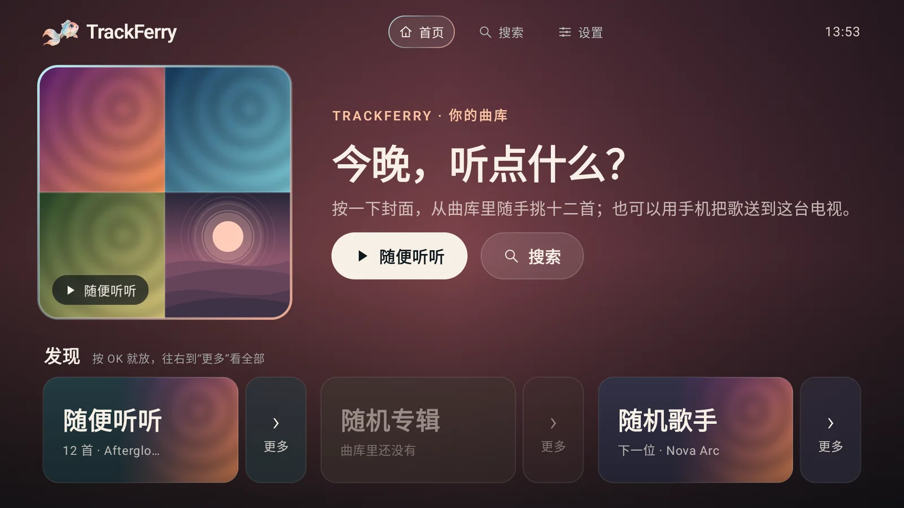 | 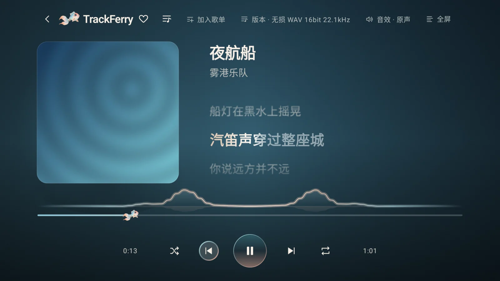 |

电视应用在 [Releases](https://github.com/madrays/trackferry/releases) 下载：64 位盒子用 `trackferry-tv-<版本>-android-arm64-v8a.apk`，32 位用 `trackferry-tv-<版本>-android-armeabi-v7a.apk`（拿不准就用 32 位的，64 位盒子也能装），之后可以在设置页一键更新。说明见 [docs/android-tv.md](docs/android-tv.md)。

<sub>截图全部使用演示数据：歌是生成的，乐队是虚构的，音箱是模拟的。</sub>

## 快速开始

准备一台装有 Docker 的 NAS（amd64 或 arm64；32 位 armv7 也有镜像，但还没在实机上测过），以及同一局域网内的小爱音箱。没有小爱也能用，只当电视和投放的总控。

**1. 下载部署文件**

```sh
mkdir -p trackferry && cd trackferry && curl -fLO https://raw.githubusercontent.com/madrays/trackferry/main/compose.yaml
```

**2. 修改地址**

打开 `compose.yaml`，把 `TRACKFERRY_URL` 改成 NAS 的局域网地址：

```yaml
TRACKFERRY_URL: "http://192.168.1.10:18561"
```

**3. 启动**

```sh
docker compose up -d
```

**4. 查看初始化码**

```sh
docker exec trackferry /trackferry setup-code
```

**5. 完成设置**

打开 `http://<NAS 地址>:18561`，设置管理密码，登录小米账号和飞牛音乐（或挂好音乐文件夹）。先把音箱设为“观察”，看过流转觉得靠谱，再改成“接管”。

**6. 装到手机**

iPhone 用 Safari 打开，分享 → 添加到主屏幕。安卓和电脑见[装到手机或电脑桌面](docs/usage.md#装到手机或电脑桌面)。

> [!IMPORTANT]
> 接管前，先让 xiaomusic 等程序退出对这台音箱的控制。一只喇叭只能有一个神。

> [!TIP]
> 管理页打不开或音箱不出声，多半是防火墙没放行 TCP 18561。用电视端还要放行 18562/TCP 和 5353/UDP，投放到 DLNA 还要放行 1900/UDP。见[部署教程](docs/deployment.md#第四步放行端口)。

<details>
<summary><b>更新</b></summary>

“设置 → 关于”会提示新版本，点“更新”即可，起不来会自动退回。

也可以用命令：先备份 `data`，再在 `compose.yaml` 所在目录执行：

```sh
docker compose pull && docker compose up -d
```

</details>

<details>
<summary><b>从源码构建</b></summary>

```sh
git clone https://github.com/madrays/trackferry.git && cd trackferry
```

修改 `compose.yaml` 后执行：

```sh
docker compose -f compose.yaml -f compose.build.yaml up -d --build
```

</details>

## 文档

| 使用 | 了解与参与 |
| --- | --- |
| 🚀 [部署教程](docs/deployment.md) | 🧭 [架构](docs/architecture.md) |
| 🗣️ [使用说明](docs/usage.md) | 🔌 [接口](docs/api.md) |
| 📱 [装到手机](docs/usage.md#装到手机或电脑桌面) | 🎧 [音箱的三种模式](docs/usage.md#音箱的三种模式) |
| 📺 [电视端](docs/android-tv.md) | 🔁 [连续播放](docs/usage.md#连续播放) |
| 🏠 [接入 Home Assistant](docs/homeassistant.md) | 🤝 [参与贡献](CONTRIBUTING.md) |
| ⚙️ [配置](docs/configuration.md) | 📝 [更新记录](CHANGELOG.md) |
| 🩺 [问题排查](docs/troubleshooting.md) | 💛 [致谢](docs/credits.md) |
| 🔐 [隐私与安全](docs/security.md) | |

## 参与

问题和建议请提 [Issue](https://github.com/madrays/trackferry/issues)，改代码前看一下[贡献说明](CONTRIBUTING.md)。

<div align="center">

喜欢 TrackFerry 的话，点个 ⭐ 吧。

<a href="https://star-history.com/#madrays/trackferry&Date">
  <picture>
    <source media="(prefers-color-scheme: dark)" srcset="https://api.star-history.com/svg?repos=madrays/trackferry&type=Date&theme=dark">
    
  </picture>
</a>

</div>

## 致谢与许可

感谢 [xiaomusic](https://github.com/hanxi/xiaomusic)、[fnmusic-miot](https://github.com/le5inioo/fnmusic-miot)、[songloft-plugin-miot](https://github.com/songloft-org/songloft-plugin-miot)、[fnos_music_ext](https://github.com/javycoder/fnos_music_ext) 和 [musicdl](https://github.com/CharlesPikachu/musicdl)。

TrackFerry 以 [MIT](LICENSE) 许可开源。
